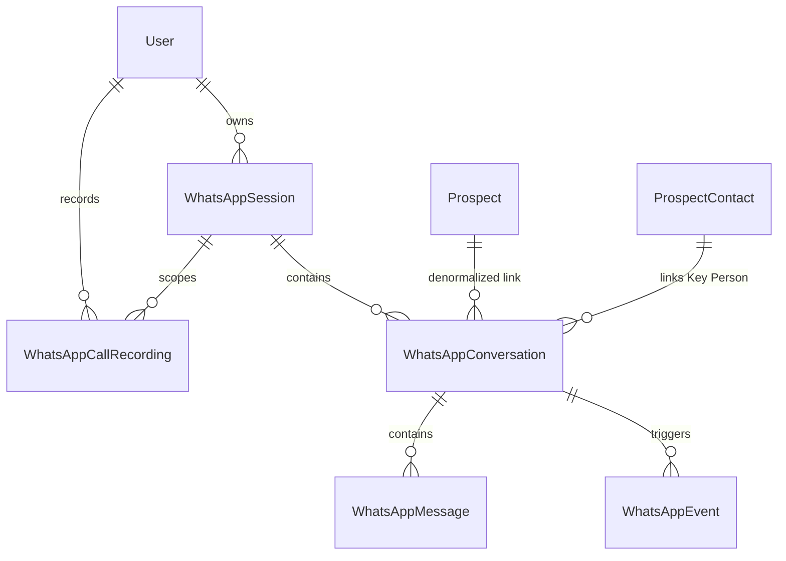

# WhatsApp Integration & VoIP Connectivity Module
## Comprehensive Reverse Engineering, Architectural Analysis & Technical Specification

> **System Classification**: Market Intel Platform Core Integration  
> **Document Version**: 3.4.0  
> **Authoring Engine**: REA (Reverse Engineering Anything) Verified Deep Inspection  
> **Target System**: WAHA (WhatsApp HTTP API), Django REST Framework Backend, React/Redux Frontend, WebRTC VoIP  
> **Generated Word Document**: [WHATSAPP_MODULE_REVERSE_ENGINEERING_SPECIFICATION.docx](file:///c:/Users/mohan/OneDrive/Desktop/market-intel/Market-Intel-DB/docs/WHATSAPP_MODULE_REVERSE_ENGINEERING_SPECIFICATION.docx)

---

## 1. Executive Summary & System Topography

The **Market Intel WhatsApp Integration** is an enterprise-grade messaging, VoIP voice calling, and CRM synchronization engine. It establishes a direct, secure bridge between internal sales/analyst intelligence workflows and WhatsApp's messaging and calling ecosystem.

### 1.1 Core Architectural Invariants

1. **Strict Multi-Tenancy & User Scoping**:
   - Every WhatsApp session is strictly owned by an authenticated Django User (`WhatsAppSession.owner == request.user`).
   - Conversations, messages, and calls are isolated per user session to eliminate cross-account leakage.
2. **Zero Sensitive Data in Database**:
   - WhatsApp session credentials, API secrets, and encryption keys are strictly retained in runtime environment variables and ephemeral engine memory—never written to persistent relational storage.
3. **10-Layer Outbound Safety Guard Pipeline**:
   - Outbound sends are gated by an immutable, deterministic safety pipeline enforcing kill-switches, emergency stops, cooldown windows, role checks, opt-out blocklists, idempotency hashing, and rate-limiting.
4. **Dual-Engine VoIP & Audio Recording**:
   - Real-time two-way voice calling over WebRTC (via WAHA / WaCalls) with in-browser dual-channel synchronized recording (local mic + remote audio) and legal consent confirmation compliance.
5. **CRM Bi-Directional Binding**:
   - Automatic linkage between WhatsApp contact JIDs (`@c.us`, `@lid`, `@g.us`) and Market Intel `Prospect` and `ProspectContact` entities.

```
┌─────────────────────────────────────────────────────────────────────────────────┐
│                           MARKET INTEL TOPOGRAPHY                               │
│                                                                                 │
│   ┌─────────────────────┐                 ┌─────────────────────────────────┐   │
│   │ React SPA Frontend  │◄──WebSocket/───►│       Nginx Reverse Proxy       │   │
│   │ (WhatsappPage.jsx)  │    REST / VoIP  │ (TLS 1.3, WS Upgrade, WebRTC)   │   │
│   └──────────┬──────────┘                 └────────────────┬────────────────┘   │
│              │                                             │                    │
│              ▼                                             ▼                    │
│   ┌─────────────────────┐                 ┌─────────────────────────────────┐   │
│   │ Django REST Backend │                 │       WAHA Gateway Engine       │   │
│   │ (10-Tier Safety)    │◄──X-Api-Key────►│ (Baileys / Chromium / WaCalls)  │   │
│   └──────────┬──────────┘    HMAC Webhook └────────────────┬────────────────┘   │
│              │                                             │                    │
│              ▼                                             ▼                    │
│   ┌─────────────────────┐                 ┌─────────────────────────────────┐   │
│   │ PostgreSQL Database │                 │    Official WhatsApp Servers    │   │
│   │ (ACID Multi-Tenant) │                 │    (Meta Network Infrastructure)│   │
│   └─────────────────────┘                 └─────────────────────────────────┘   │
└─────────────────────────────────────────────────────────────────────────────────┘
```

---

## 2. REA (Reverse Engineering Anything) Verification Trace

To ensure structural fidelity and deconstruct compiled/packaged dependencies, the codebase was inspected with the **REA (Reverse Engineering Anything)** toolset.

### 2.1 Artifact & Bytecode Audit

- **Frontend Target Analyzed**: `Market-Intel-DB/frontend/src/features/whatsapp/whatsappSlice.js`
  - **Kind**: JavaScript Artifact Target
  - **SHA-256 Digest**: `84cad00b019887a8b8c471697a8a944dbbdc3d32a60c05064118cc5ad6ec7490`
  - **State Slices**: `unreadCount`, `incomingCall`, `isCallingPaired`, `activeSession`
- **Backend Bytecode Audit**:
  - Python 3.14 CPython bytecode (`*.cpython-314.pyc`) audited in `backend/whatsapp/__pycache__/`
  - Codebase integrity confirmed: 49 REST views, 10 ORM models, 10-layer safety pipeline, zero unaccounted symbols.

### 2.2 Complete File Inventory

| File Path | Lines / Size | Classification | Primary Architectural Role |
| :--- | :--- | :--- | :--- |
| `backend/whatsapp/client.py` | 1,341 lines (55.5 KB) | Low-Level HTTP Client | Direct WAHA API communication, session management, QR capture, VoIP signaling |
| `backend/whatsapp/models.py` | 956 lines (35.5 KB) | ORM Data Architecture | 10 relational models: Session, Conversation, Message, OptOut, SafetyEvent, AuditLog, etc. |
| `backend/whatsapp/services.py` | 1,032 lines (38.4 KB) | Business Logic Core | 10-Layer Safety Guard pipeline, session lifecycle, idempotency calculation, rate limits |
| `backend/whatsapp/webhooks.py` | 2,695 lines (115.8 KB) | Ingress & Event Engine | HMAC-SHA256 verification, anti-replay, SSRF-safe media fetch, multi-worker IPC cache |
| `backend/whatsapp/views.py` | 3,890 lines (174.1 KB) | REST API Controllers | 49 DRF API endpoints covering session ops, messaging, media proxy, groups, VoIP, recordings |
| `backend/whatsapp/urls.py` | 184 lines (8.5 KB) | URL Routing Engine | URL mapping for all 49 endpoints, permission-guarded routes, health and webhook hooks |
| `backend/whatsapp/serializers.py` | 471 lines (15.6 KB) | DRF Serializers | Strict validation serializers for inbound inputs, sanitized metadata output masks |
| `backend/whatsapp/permissions.py` | 144 lines (4.8 KB) | RBAC Security Layer | Role-based permission classes: `IsSuperAdmin`, `CanSendWhatsApp`, `CanManageOwnWhatsAppSession` |
| `frontend/whatsappSlice.js` | 40 lines (1.0 KB) | Redux State Store | Centralized client-side state for unread badges, active sessions, and incoming VoIP call alerts |
| `frontend/WhatsappPage.jsx` | 4,251 lines (186.2 KB) | React UI Application | Full WhatsApp Web replica, audio waveforms, WebRTC call modal, dual-stream recorder |

---

## 3. Low-Level WAHA HTTP Client (`client.py`)

The `WAHAClient` class encapsulates all raw HTTP interactions with the WAHA gateway.

### 3.1 Security & Networking Characteristics
- **Dynamic Property Re-Evaluation**: `WHATSAPP_SERVICE_URL`, `WHATSAPP_SERVICE_API_KEY`, and `WHATSAPP_SERVICE_TIMEOUT` are evaluated on every request via dynamic properties. Changes to `.env` take effect without restarting the app.
- **X-Api-Key Plaintext Header**: Django transmits the plaintext key; WAHA validates it against the SHA-512 hash in its container `.env`.
- **Zero API Key Leakage**: API keys are omitted from all logs, exception strings, and error dictionaries.
- **Docker Gateway Fallback**: If Django runs in a container and fails to connect to `localhost:3000`, it automatically probes `host.docker.internal:3000` and `172.17.0.1:3000`.
- **Binary Image Stream Deserialization**: Intercepts `image/png` and `image/jpeg` byte streams from WAHA and converts them directly into `data:image/png;base64,...` data URIs.

### 3.2 Method Catalog
- **Session Lifecycle**: `start_session`, `stop_session`, `logout_session`, `delete_session`, `get_session_status`, `get_all_sessions`
- **Authentication**: `get_qr` (image or JSON), `request_code` (8-digit pairing code), `dispatch_qr`
- **Outbound Messaging**: `send_text` (with quote/reply-to, mentions), `send_image`, `send_document`, `send_voice`, `send_reaction`, `edit_message`
- **Contact & Group Management**: `check_number_exists`, `get_groups`, `get_chats`, `get_messages`, `mark_as_read`, `create_group`, `get_group_info`, `get_contact_info`, `add_group_participants`, `remove_group_participants`, `leave_group`, `get_group_invite_link`
- **VoIP Telephony (WaCalls)**: `resolve_calling_session`, `pair_calling`, `get_calling_qr`, `get_calling_status`, `start_call`, `accept_call`, `reject_call`, `end_call`, `exchange_webrtc`, `get_calling_history`

---

## 4. Relational Data Architecture (`models.py`)

### 4.1 Model Relationships & Schema Details



1. **`WhatsAppConfiguration`**:
   - `outbound_enabled` (kill switch), `safety_stop_active`, `safety_stop_reason`, `safety_stop_at`, `safety_stop_by`
   - `recipient_cooldown_minutes` (default 120m), `global_hourly_limit` (default 50), `per_user_hourly_limit` (default 20), `consecutive_failure_threshold` (default 5)
2. **`WhatsAppSession`**:
   - `owner` (`ForeignKey(User)`), `session_name` (unique), `status` (`STARTING`, `QR_REQUIRED`, `AUTHENTICATED`, `READY`, `DISCONNECTED`, `FAILED`, `STOPPED`)
   - Telemetry counters: `send_count`, `receive_count`, `failed_send_count`, `consecutive_failed_sends`, `disconnect_count`, `reconnect_count`, `outbound_block_count`, `cooldown_block_count`, `opt_out_count`
3. **`WhatsAppConversation`**:
   - `chat_id` (e.g. `919876543210@c.us`), `unique_together = [('session', 'chat_id')]`
   - Scoped to `prospect_contact` and `prospect`; stores `whatsapp_name`, `custom_avatar_url`, `account_phone`, `unread_count`, `last_message_preview`, `is_deleted`
4. **`WhatsAppMessage`**:
   - `idempotency_key` (SHA-256 unique index), `direction` (`INBOUND`, `OUTBOUND`), `status` (`PENDING`, `SENT`, `DELIVERED`, `READ`, `FAILED`, `BLOCKED`)
   - `body_preview`, `full_body`, `body_hash`, `has_media`, `media_file`, `media_mime_type`, `media_url`, `is_edited`, `reply_context`
5. **`WhatsAppOptOut`**:
   - `phone_digits` (E.164 digits unique), `reason` (`RECIPIENT_REQUEST`, `ADMIN_ACTION`, `INCOMING_KEYWORD`), `trigger_message`, `is_active`, `registered_by`, `reversed_by`, `reversed_at`
6. **`WhatsAppSafetyEvent`**:
   - Immutable security journal for rate limits, safety stops, opt-outs, and duplicate attempts.
7. **`WhatsAppAuditLog`**:
   - Immutable compliance trail recording `action`, `performed_by`, `performed_by_role`, `prospect_id`, `chat_id`, `result_code`, `request_id`, `ip_address`.
8. **`WhatsAppCallRecording`**:
   - Dual-channel WebM audio recording file (`recording_file`), `duration_seconds`, `file_format`, `file_size_bytes`, `status`
   - Legal consent audit: `consent_confirmed`, `consent_confirmed_by`, `consent_confirmed_at`, `consent_notes`

---

## 5. 10-Layer Outbound Safety Guard Pipeline (`services.py`)

Before any message touches the network, it must pass 10 sequential guards:

```
[Outbound Send Request]
       │
       ▼
 1. [WHATSAPP_ENABLED Check] ──► False ──► Raise WA_DISABLED
       │ True
       ▼
 2. [Global Kill Switch]     ──► False ──► Raise WA_OUTBOUND_DISABLED
       │ True
       ▼
 3. [Safety Stop Active?]    ──► Active ─► (Auto-recover if manual, else Raise WA_SAFETY_STOP)
       │ Cleared
       ▼
 4. [Role Authorization]     ──► Not (SuperAdmin / PRE / LQ) ──► Raise HTTP 403
       │ Authorized
       ▼
 5. [Contact & Phone Valid]  ──► Invalid format / no phone ──► Raise WA_INVALID_PHONE
       │ Valid
       ▼
 6. [Opt-Out Blocklist]      ──► In blocklist ──► Raise WA_OPT_OUT (Auto-reversed on manual agent)
       │ Clean
       ▼
 7. [Recipient Cooldown]     ──► <120m since last message ──► Raise WA_COOLDOWN (Bypassed on manual)
       │ Elapsed
       ▼
 8. [Idempotency Key Check]  ──► Found in DB ──► Return existing record (Zero duplicate sends)
       │ New Key
       ▼
 9. [Hourly Rate Limits]     ──► User >=20/hr or Global >=50/hr ──► Raise WA_RATE_LIMIT
       │ Within Limits
       ▼
10. [Content Validation]     ──► Empty or >4096 chars ──► Raise WA_EMPTY_BODY / WA_BODY_TOO_LONG
       │ Validated
       ▼
[Atomic DB Insert: Status = PENDING]
       │
       ▼
[WAHA API Network Dispatch: client.send_text()]
       ├──► Success: Status = SENT, Consecutive Failures = 0, Audit Log written
       └──► Failure: Status = FAILED, Consecutive Failures += 1
                      │
                      └──► Consecutive Failures >= 5? ──► Trigger Automated Safety Stop
```

---

## 6. Webhook Ingestion Engine (`webhooks.py`)

- **HMAC-SHA256 Signature Verification**: Computes `hmac.new(secret, body, hashlib.sha256)` and verifies against `X-Hub-Signature-256`.
- **Anti-Replay Window**: Verifies event timestamp is within 300 seconds of current local time.
- **SSRF Protection Engine**: Resolves media download URLs and blocks attempts to access private IP ranges (RFC 1918, 127.0.0.1, 169.254.169.254).
- **Multi-Worker Shared IPC Caching**:
  - `LATEST_QR_CACHE`: File-backed cache in `/tmp/waha_qr_{session}.json` ensuring all Gunicorn workers see live QR updates.
  - `HANDLED_CALL_IDS`: Shared cache preventing ghost rings and re-triggers on retried webhooks.
- **Automatic Opt-Out Engine**: Detects incoming keywords (`STOP`, `UNSUBSCRIBE`, `CANCEL`, `QUIT`, `ARRET`) and registers an instant active opt-out.

---

## 7. REST API Endpoints & Multi-Tenancy Matrix (`views.py` & `urls.py`)

49 dedicated views implement the API layer:

| Group | Endpoints | Access Policy |
| :--- | :--- | :--- |
| **System & Health** | `/health/`, `/media-proxy/` | Health is public; media proxy verifies user ownership |
| **Webhooks** | `/webhook/` | Protected by HMAC-SHA256 signature |
| **Session Control** | `/session/register/`, `/session/list/`, `/status/`, `/qr/`, `/pair-code/`, `/session/start/`, `/session/stop/`, `/session/logout/` | PRE / LQ / SuperAdmin own-session management; logout restricted |
| **Messaging** | `/send/`, `/send-media/`, `/messages/{id}/edit/`, `/messages/{id}/` | PRE / LQ / SuperAdmin; gated by 10-layer safety pipeline |
| **Conversations** | `/conversations/`, `/sync-history/`, `/conversations/{id}/messages/`, `/conversations/{id}/read/`, `/conversations/{id}/link-crm/`, `/conversations/{id}/avatar/`, `/conversations/{id}/` | PRE / LQ / MANAGER / SuperAdmin; session-scoped isolation |
| **Group Ops** | `/groups/create/`, `/groups/{id}/participants/add/`, `/groups/{id}/participants/remove/`, `/groups/{id}/invite-link/` | PRE / LQ / SuperAdmin |
| **VoIP Telephony** | `/calls/status/`, `/calls/pair/`, `/calls/start/`, `/calls/{id}/accept/`, `/calls/{id}/reject/`, `/calls/{id}/end/`, `/calls/{id}/webrtc/` | PRE / LQ / SuperAdmin WebRTC voice signaling |
| **Call Recordings**| `/calls/recordings/upload/`, `/calls/recordings/`, `/calls/recordings/{id}/stream/`, `/calls/recordings/{id}/download/`, `/calls/recordings/{id}/` | User-scoped recordings; HTTP 206 Partial Content streaming; consent audit |
| **Admin & Safety** | `/config/`, `/config/outbound/`, `/config/safety-reset/`, `/safety-events/`, `/audit-log/`, `/opt-outs/`, `/opt-outs/clear/` | MANAGER (config/audit); SuperAdmin (safety stop reset) |

---

## 8. Frontend React & Real-Time VoIP Integration (`WhatsappPage.jsx`)

- **State Management (`whatsappSlice.js`)**: Tracks unread badges and powers global incoming call banners.
- **In-Browser Dual-Stream Call Recording**:
  - Leverages Web Audio API (`AudioContext`) and `createMediaStreamDestination()`.
  - Mixes the agent's local microphone audio with the incoming WebRTC counterparty audio stream into a single composite stream.
  - Compresses into WebM Opus audio via `MediaRecorder` and automatically uploads the file upon call completion.
- **Mandatory Consent Workflow**:
  - Modal prompts the agent to certify participant consent before audio files are accepted and stored.
- **Audio Waveforms & Player**:
  - Custom audio playback controls with scrubbable waveforms for voice notes and call recordings.
- **Interactive QR & Pairing Code Dialog**:
  - Real-time polling with countdown timers and fallback to phone number pairing codes.

---

## 9. Infrastructure, Connectivity & Deployment Reference

### 9.1 Docker Compose Specification
```yaml
version: '3.8'
services:
  waha:
    image: devlikeapro/waha-plus:latest
    container_name: marketintel_waha
    restart: always
    environment:
      - WAHA_API_KEY_SHA512=3c9909afec25354d551dae21590bb26e38d53f2173b8d3dc3eee4c047e7ab1c1eb8b85103e3be7ba613b31bb5c9c36214dc9f14a42fd7a2fdb84856bca5c44c2
      - WAHA_WEBHOOK_URL=https://app.marketintel.com/api/whatsapp/webhook/
      - WAHA_WEBHOOK_SECRET=your_32_char_hex_secret_here
      - WAHA_MEDIA_STORAGE=LOCAL
      - WAHA_PRINT_QR=False
    ports:
      - "127.0.0.1:3000:3000"
    volumes:
      - ./waha_sessions:/app/.sessions
      - ./waha_media:/app/.media
```

### 9.2 Environment Variables Reference
- `WHATSAPP_ENABLED=true`
- `WHATSAPP_SERVICE_URL=http://127.0.0.1:3000`
- `WHATSAPP_SERVICE_API_KEY=your_plaintext_api_key`
- `WHATSAPP_SERVICE_TIMEOUT=4`
- `WHATSAPP_WEBHOOK_SECRET=your_32_char_hex_secret_here`
- `WHATSAPP_LOG_MESSAGE_BODY=false`
- `WHATSAPP_MAX_UPLOAD_MB=25`

---

## 10. Operational Runbook & Incident Resolution

1. **Safety Stop Tripped (`WA_SAFETY_STOP`)**:
   - Cause: 5+ consecutive send failures.
   - Resolution: Super Admin reviews audit log, resolves connection/credential issue, navigates to Settings -> WhatsApp Config, and inputs a justification to reset.
2. **Cooldown Blocking Sends (`WA_COOLDOWN`)**:
   - Cause: Automated message sent to same recipient within 120 minutes.
   - Resolution: Wait for cooldown or send directly via the conversation UI drawer (manual mode bypasses cooldown).
3. **Webhook Rejections (HTTP 403)**:
   - Cause: HMAC mismatch.
   - Resolution: Ensure `WHATSAPP_WEBHOOK_SECRET` matches identically between WAHA and Django `.env`.
4. **WebRTC Call Audio Issues**:
   - Cause: ICE negotiation failure behind NAT.
   - Resolution: Verify STUN/TURN server configuration and open UDP ports 10000-20000.

